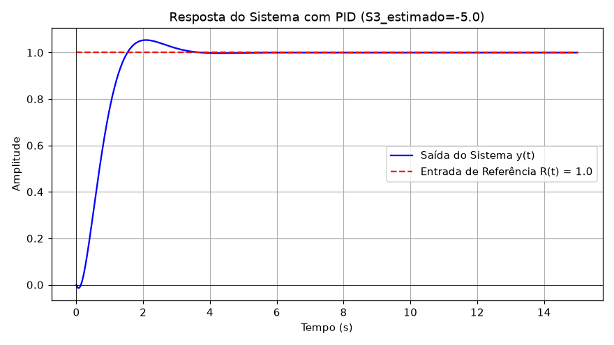

# 📈 Simulador de Controle PID

Aplicativo em Python com interface gráfica que projeta um controlador PID por **alocação de polos** e simula a resposta ao degrau do sistema em malha fechada.

<p align="center">
  
</p>

## Como funciona

A planta usada é o processo de segunda ordem

$$P(s) = \frac{6}{s^2 + 8{,}3\,s + 13{,}42}$$

Com o controlador $C(s) = \dfrac{K_d s^2 + K_p s + K_i}{s}$, a equação característica da malha fechada é de terceira ordem. O simulador:

1. fixa um par de polos complexos conjugados com $\zeta = 0{,}707$ e $\omega_n = 2$ rad/s;
2. usa o terceiro polo $s_3$ informado pelo usuário (precisa ser negativo, ou seja, estável; para o par complexo dominar a resposta, use $s_3 < -1{,}414$);
3. iguala os coeficientes do polinômio desejado aos da malha fechada para obter $K_p$, $K_i$ e $K_d$;
4. simula a resposta a um degrau de amplitude $a$ com `scipy.signal.lsim` e mostra o gráfico na janela.

Com $s_3 = -5$, por exemplo, o resultado é $K_p \approx 0{,}787$, $K_i \approx 3{,}333$ e $K_d \approx -0{,}079$, com sobressinal de cerca de 5% e acomodação em ~3 s.

## Tecnologias

- Python 3
- NumPy e SciPy (funções de transferência e simulação)
- Matplotlib (gráfico embutido na interface)
- Tkinter (interface gráfica)

## Como executar

```bash
pip install -r requirements.txt
python simulador_pid.py
```

Na janela, informe o polo $s_3$ e a amplitude do degrau e clique em **Simular Resposta**. Os ganhos calculados aparecem acima do gráfico.

## Licença

[MIT](LICENSE)
